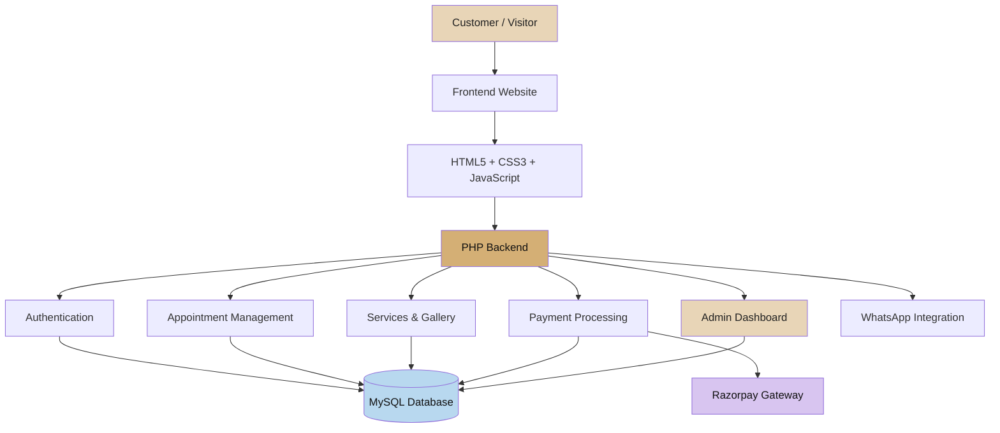
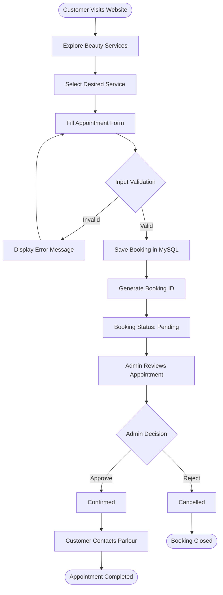
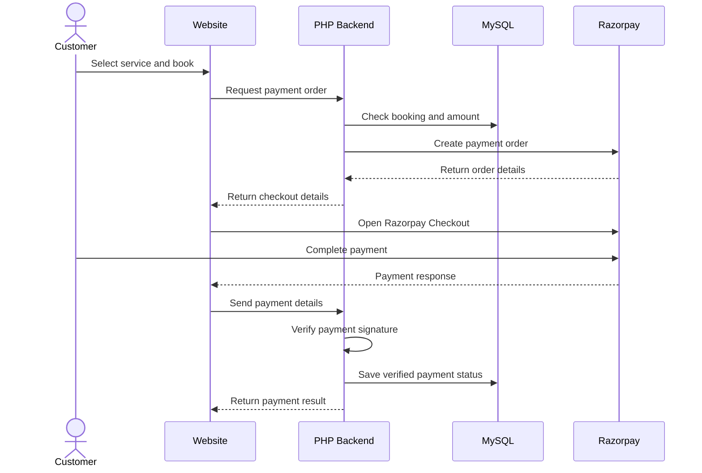

# ✨ Kanak Beauty Parlour
### Beauty That Makes You Shine.

<p align="center">
  <strong>A Premium Beauty, Bridal Makeup & Salon Management Website</strong>
</p>

<p align="center">
  A modern, elegant and responsive web application designed to showcase beauty services, manage customer appointments, display makeup portfolios, and simplify salon operations.
</p>

<p align="center">
  
  
  
  
  
</p>

---

## 💎 About The Project

**Kanak Beauty Parlour** is a premium beauty salon website developed to establish a professional online presence for a beauty and makeup business.

The platform helps customers explore beauty services, view makeup collections, book appointments, and contact the parlour conveniently.

It also provides an administrative interface to manage appointments, services, gallery images, and business information.

### Business Information

| Detail | Information |
|---|---|
| Business Name | Kanak Beauty Parlour |
| Owner | Kavita Kawadker |
| Tagline | Beauty That Makes You Shine. |
| Location | Chandrashekhar Ward, Sadar, Betul, Madhya Pradesh |
| Phone | 8839131870 |
| Instagram | @kavita_kawadker_makeup_artist |
| Business Hours | 10:00 AM – 8:00 PM |

---

## 🎯 Project Objectives

- Build a premium digital identity for Kanak Beauty Parlour.
- Showcase professional makeup and beauty services.
- Make appointment booking simple and convenient.
- Provide an organized administration system.
- Improve customer engagement through WhatsApp integration.
- Support secure online payment integration.
- Deliver a responsive experience across desktop, tablet, and mobile devices.

---

## 🚀 Key Features

### 1. Customer Website

- Premium and elegant homepage.
- About the parlour section.
- Beauty and makeup services.
- Bridal and party makeup portfolio.
- Responsive image gallery.
- Customer testimonials.
- Contact information.
- Instagram and WhatsApp integration.

### 2. Appointment Booking System

- Customer information form.
- Service selection.
- Appointment date and time selection.
- Booking ID generation.
- Appointment status tracking.
- Admin approval system.
- Database-based appointment storage.

### 3. Admin Dashboard

- Secure admin authentication.
- Dashboard overview.
- Appointment management.
- Service management.
- Gallery management.
- Customer review management.
- Business settings.
- Booking status updates.

### 4. Payment Integration

- Razorpay payment gateway integration.
- Backend order creation.
- Server-side payment signature verification.
- Payment status management.
- Transaction ID storage.

**Note:** Live online payments require valid Razorpay API credentials and configuration.

### 5. Security

- PHP PDO database connectivity.
- Prepared SQL statements.
- Password hashing.
- Session-based authentication.
- CSRF protection.
- Server-side validation.
- Secure file upload validation.

---

## 🛠️ Technology Stack

| Technology | Purpose |
|---|---|
| HTML5 | Website structure |
| CSS3 | Styling and responsive layouts |
| JavaScript | Client-side interactions |
| Bootstrap 5 | Responsive UI components (if used) |
| PHP 8+ | Backend development |
| MySQL | Database management |
| PDO | Secure database connectivity |
| Razorpay | Online payment integration |
| XAMPP | Local development environment |
| Git & GitHub | Version control |

---

## 🏗️ System Architecture

The following diagram illustrates the overall architecture of the application.



## 🔄 Appointment Booking Workflow

This diagram explains how a customer books an appointment.



## 💳 Payment Workflow



---

## 📂 Project Folder Structure

```text
kanak-beauty-parlour/
│
├── admin/
│   ├── login.php
│   ├── dashboard.php
│   └── ...admin management files
│
├── api/
│   ├── book_appointment.php
│   └── payment.php
│
├── assets/
│   ├── css/
│   │   └── style.css
│   ├── js/
│   │   └── script.js
│   └── images/
│
├── config/
│   └── database.php
│
├── includes/
│   ├── header.php
│   ├── footer.php
│   └── functions.php
│
├── uploads/
│
├── index.php
├── about.php
├── services.php
├── gallery.php
├── appointment.php
├── contact.php
│
├── database.sql
├── .env.example
├── .gitignore
└── README.md
```

*The structure above represents the intended application organization; optional files and implementation details may vary in your working project.*

---

## ⚙️ Installation & Setup

Follow these instructions to run the project locally on Windows.

### Prerequisites

Install the following:

- [PHP / XAMPP](https://www.apachefriends.org/)
- [Visual Studio Code](https://code.visualstudio.com/)
- Web browser
- MySQL and phpMyAdmin (included with XAMPP)

### Step 1: Clone the Repository

Open your terminal and execute:

```bash
git clone https://github.com/YOUR-USERNAME/kanak-beauty-parlour.git
```

Navigate into the project:

```bash
cd kanak-beauty-parlour
```

Replace `YOUR-USERNAME` with your actual GitHub username.

### Step 2: Configure XAMPP

Copy the project folder into:

```text
C:\xampp\htdocs\kanak-beauty-parlour
```

### Step 3: Configure Environment Variables

Create a private `.env` file using `.env.example`.

PowerShell command:

```powershell
Copy-Item .env.example .env
```

Configure your local database settings:

```env
DB_HOST=localhost
DB_NAME=kanak_beauty_parlour
DB_USER=root
DB_PASS=

RAZORPAY_KEY_ID=your_razorpay_key_id
RAZORPAY_KEY_SECRET=your_razorpay_key_secret

APP_URL=http://localhost/kanak-beauty-parlour
APP_ENV=development
```

Use your actual local database credentials. Keep `.env` private and never upload it to GitHub.

### Step 4: Create MySQL Database

1. Open phpMyAdmin.
2. Create a new database named:

```sql
CREATE DATABASE kanak_beauty_parlour
CHARACTER SET utf8mb4
COLLATE utf8mb4_unicode_ci;
```

3. Select the newly created database.
4. Open the Import tab.
5. Choose `database.sql`.
6. Select SQL format.
7. Click Go.

### Step 5: Configure Database Connection

Verify that `config/database.php` reads the environment variables and uses PHP PDO.

The local database configuration should match the `.env` file.

### Step 6: Launch Website

Open your browser:

```text
http://localhost/kanak-beauty-parlour/
```

Admin login:

```text
http://localhost/kanak-beauty-parlour/admin/login.php
```

Create your first administrator account using the secure setup procedure documented in the project. Do not rely on default credentials.

---

## 📸 Website Screenshots

Add your actual website screenshots here after running the application successfully.

| Page | Screenshot |
|---|---|
| Homepage | Add homepage screenshot |
| About | Add about page screenshot |
| Services | Add services screenshot |
| Gallery | Add gallery screenshot |
| Appointment | Add booking screenshot |
| Admin Dashboard | Add dashboard screenshot |

To display a screenshot hosted in your repository, use:

```markdown

```

Recommended screenshot folder:

```text
screenshots/
├── homepage.png
├── about.png
├── services.png
├── gallery.png
├── appointment.png
└── admin-dashboard.png
```

---

## 🔐 Security & Best Practices

- Never commit `.env` files.
- Use prepared statements for SQL queries.
- Store passwords using secure hashing.
- Validate all user input on the server.
- Restrict image uploads to permitted formats and sizes.
- Protect administrative routes.
- Verify Razorpay signatures on the server.
- Never store card numbers or CVV information.
- Use HTTPS when deploying to production.

---

## 🧪 Testing Checklist

- [ ] Homepage loads correctly.
- [ ] Navigation links work.
- [ ] Services display correctly.
- [ ] Gallery images load.
- [ ] Appointment form validation works.
- [ ] Booking information saves to MySQL.
- [ ] Duplicate confirmed appointment conflicts are prevented.
- [ ] Admin authentication works.
- [ ] Appointment management works.
- [ ] Gallery upload works.
- [ ] WhatsApp integration works.
- [ ] Razorpay test payment is verified.
- [ ] Mobile responsiveness is checked.

*Testing status should be updated after executing each test in the local environment.*

---

## 🔮 Future Enhancements

- Customer registration and login.
- Automated appointment reminders.
- Email and WhatsApp booking notifications.
- Advanced analytics dashboard.
- Customer booking history.
- Online offer and coupon management.
- Advanced service search and filtering.
- Cloud image storage.
- Production deployment with a custom domain.

---

## 👩‍💻 Project Information

**Project:** Kanak Beauty Parlour

**Owner:** Kavita Kawadker

**Developer:** Vinit Kawadker

**Project Type:** Full-Stack Web Development

**Domain:** Beauty & Salon Management

**Location:** Betul, Madhya Pradesh, India

---

## 📞 Contact & Connect

- **Phone / WhatsApp:** +91 8839131870
- **Instagram:** [@kavita_kawadker_makeup_artist](https://www.instagram.com/kavita_kawadker_makeup_artist/)

---

## ⭐ Support

If you like this project, consider giving this repository a ⭐ on GitHub.

Your support and feedback are appreciated!

<p align="center">
  <strong>Kanak Beauty Parlour</strong><br/>
  <em>Beauty That Makes You Shine.</em>
</p>
